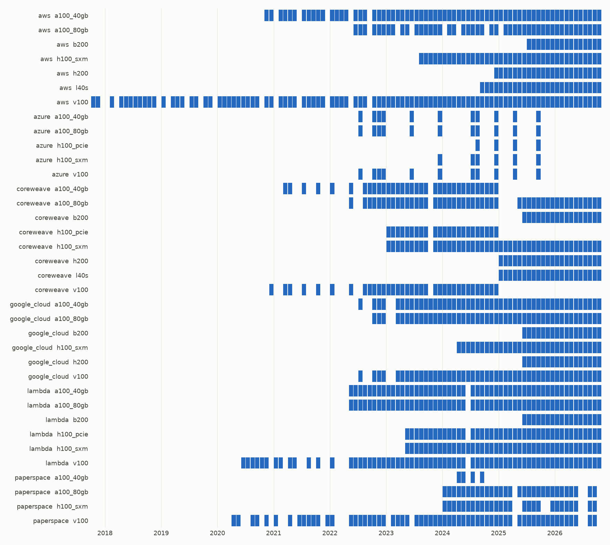

# Historical coverage

Generated by `python -m gel.build.historical`: 35733 rows of prices.

Each filled cell is a month with at least one price for that provider and chip. A
blank is a gap, because prices are never carried forward. Months are not equally
informative: most on-demand prices barely move.

## Coverage by provider and chip

| provider | chip | first | last | months | rows |
| --- | --- | --- | --- | --- | --- |
| aws | a100_40gb | 2020-11 | 2026-10 | 67 | 930 |
| aws | a100_80gb | 2022-06 | 2026-10 | 46 | 315 |
| aws | b200 | 2025-07 | 2026-10 | 16 | 106 |
| aws | h100_sxm | 2023-08 | 2026-10 | 39 | 800 |
| aws | h200 | 2024-12 | 2026-10 | 23 | 409 |
| aws | l40s | 2024-09 | 2026-10 | 26 | 4223 |
| aws | v100 | 2017-10 | 2026-10 | 95 | 4233 |
| azure | a100_40gb | 2022-07 | 2025-09 | 11 | 66 |
| azure | a100_80gb | 2022-07 | 2025-09 | 11 | 448 |
| azure | h100_pcie | 2024-08 | 2025-09 | 4 | 64 |
| azure | h100_sxm | 2023-12 | 2025-09 | 6 | 28 |
| azure | v100 | 2022-07 | 2025-09 | 11 | 650 |
| coreweave | a100_40gb | 2021-03 | 2024-12 | 34 | 59 |
| coreweave | a100_80gb | 2022-05 | 2026-10 | 47 | 112 |
| coreweave | b200 | 2025-06 | 2026-10 | 17 | 43 |
| coreweave | h100_pcie | 2023-01 | 2024-12 | 23 | 30 |
| coreweave | h100_sxm | 2023-01 | 2026-10 | 45 | 75 |
| coreweave | h200 | 2025-01 | 2026-10 | 22 | 51 |
| coreweave | l40s | 2025-01 | 2026-10 | 22 | 45 |
| coreweave | v100 | 2020-12 | 2024-12 | 35 | 50 |
| google_cloud | a100_40gb | 2022-07 | 2026-10 | 48 | 8122 |
| google_cloud | a100_80gb | 2022-10 | 2026-10 | 47 | 2216 |
| google_cloud | b200 | 2025-06 | 2026-10 | 17 | 343 |
| google_cloud | h100_sxm | 2024-04 | 2026-10 | 31 | 6449 |
| google_cloud | h200 | 2025-06 | 2026-10 | 17 | 259 |
| google_cloud | v100 | 2022-07 | 2026-10 | 48 | 4120 |
| lambda | a100_40gb | 2022-05 | 2026-10 | 53 | 507 |
| lambda | a100_80gb | 2022-05 | 2026-10 | 53 | 153 |
| lambda | b200 | 2025-06 | 2026-10 | 17 | 116 |
| lambda | h100_pcie | 2023-05 | 2026-10 | 41 | 73 |
| lambda | h100_sxm | 2023-05 | 2026-10 | 42 | 312 |
| lambda | v100 | 2020-06 | 2026-10 | 66 | 125 |
| paperspace | a100_40gb | 2024-04 | 2024-09 | 4 | 10 |
| paperspace | a100_80gb | 2024-01 | 2026-09 | 30 | 44 |
| paperspace | h100_sxm | 2024-01 | 2026-09 | 27 | 54 |
| paperspace | v100 | 2020-04 | 2026-09 | 62 | 93 |

## Rows by provider and source

| provider | collector | rows |
| --- | --- | --- |
| aws | aws_history | 2282 |
| aws | skypilot_history | 8734 |
| azure | skypilot_history | 1256 |
| coreweave | wayback | 465 |
| google_cloud | skypilot_history | 21509 |
| lambda | skypilot_history | 313 |
| lambda | wayback | 973 |
| paperspace | wayback | 201 |

## Rows by contract type

| contract_type | rows |
| --- | --- |
| on_demand | 13845 |
| other | 158 |
| reserved_1y | 755 |
| reserved_3y | 857 |
| spot | 20118 |
